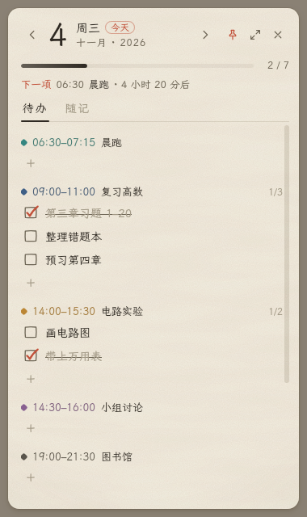
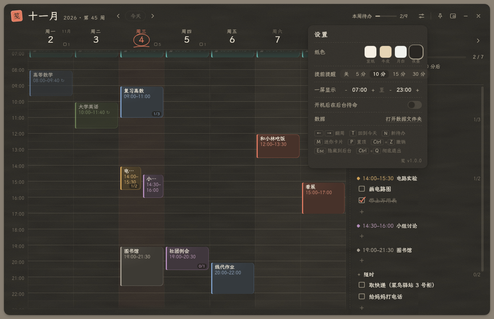

# 笺 · Quick Notes

一张常驻桌面的「纸」：左边是一周七天的日程，右边是按时间段分组的小任务。
简约、纸面质感、动效轻盈，空闲时几乎不占资源。适用于 Ubuntu / GNOME（X11）。


<p>
  
  
</p>

## 功能

- **周日程**：七天并排，拖一拖就能安排；拖动换时间、换天，拉底边改时长；支持每天 / 工作日 / 每周重复
- **TODO**：按今天的日程时间段分组列出小任务，「随时」放不绑定时间的事；点 + 添加，点方框划掉
- **之前没做完的**：过去没勾掉的任务会出现在今天，一键挪到今天
- **桌面提醒**：日程开始前弹通知，并列出这段时间还没做的小任务
- **常驻后台**：关闭只是隐藏；顶栏托盘图标随时唤出；迷你卡片可置顶在所有工作区
- **随记**：一页横线纸，随手记点什么
- **纸色**：宣纸 / 牛皮 / 月白 / 夜墨；删除可撤销；数据每日自动备份

## 安装

依赖系统自带的 `python3-gi` 与 `gir1.2-webkit2-4.0`（Ubuntu 22.04 已预装）。
顶栏托盘图标需要 AppIndicator 扩展（Ubuntu 默认已启用）。

**方式一：安装包（推荐）**

从 [Releases](https://github.com/IriceHooxi/Quick_Notes/releases) 下载 `jian_1.0.0_all.deb`，然后：

```bash
sudo apt install ./jian_1.0.0_all.deb
```

之后在「显示应用程序」里搜索「笺」，右键图标「添加到收藏夹」即可固定到任务栏。

**方式二：源码**

```bash
git clone https://github.com/IriceHooxi/Quick_Notes.git
cd Quick_Notes
./install.sh          # 创建启动器并固定到任务栏；./install.sh --uninstall 卸载
```

（源码目录就是程序本体，安装后请不要移动或删除它。）

## 用法

| 想做的事 | 怎么做 |
|---|---|
| 安排日程 | 在周视图里**按住拖动**划出时间段；或单击空白处，新建 1 小时 |
| 改日程 | 点日程块，在卡片里改标题、时间（可直接输入，或滚轮 / ↑↓ 微调）、颜色、重复、提醒、备注 |
| 挪动 / 拉长 | 拖动日程块换时间、换天；拖动块的底边改结束时间（按 15 分钟对齐） |
| 重复日程 | 卡片里选「每天 / 工作日 / 每周」；拖动重复日程时会问「仅这一次」还是「整个系列」 |
| 加小任务 | TODO 栏每个时间段下点 **+**，回车连续添加 |
| 完成 / 修改 | 点方框勾掉；双击文字修改；悬停后点 × 删除 |
| 撤销 | 提示条上的「撤销」，或 `Ctrl+Z` |
| 迷你卡片 | 右上角 ▣ 或按 `M`：缩成只看当天的小卡片，自动置顶 |

关闭窗口（× 或 Esc）只是**隐藏到后台**，提醒照常工作。顶栏的小便签图标：单击弹出菜单，双击显示 / 隐藏。
彻底退出：托盘菜单「退出」或 `Ctrl+Q`。

快捷键：`←/→` 翻周 · `↑/↓` 换天 · `T` 回到今天 · `N` 新待办 · `M` 迷你卡片 · `P` 置顶 · `Esc` 隐藏 · `Ctrl+Z` 撤销 · `Ctrl+Q` 退出

命令行：`jian`（安装包）或 `./jian.py`，可加 `--mini`、`--toggle`、`--quit`、`--hidden`、`--version`。

## 数据

- 保存在 `~/.local/share/jian/data.json`，每次修改自动保存
- 每天第一次修改前自动备份到 `backups/`，保留最近 14 天
- 换电脑时复制这个文件夹即可

## 占用

- 空闲时 CPU 为 0：只有每分钟一次的时间线刷新和每 20 秒一次的提醒检查
- 窗口打开时内存约 260MB（WebKit 渲染）；隐藏超过 20 分钟会释放网页进程，只剩约 85MB 的后台进程负责提醒和托盘，再次唤出约 0.2 秒

## 开发

```
jian.py              原生外壳：窗口、托盘、提醒、存储、单实例（Python + GTK3 + WebKit2GTK）
ui/                  界面（HTML / CSS / JS，无框架）
  fonts/wenkai/      霞鹜文楷屏幕阅读版（SIL OFL 1.1，见 OFL.txt）
assets/              图标；修改 jian.svg 后运行 make_icons.py 重新生成 PNG
install.sh           从源码安装启动器
packaging/build.sh   构建发行包（.deb 与源码 tar.gz）到 dist/
```

调试：`./jian.py --debug`（打开网页检查器，控制台输出到终端）。

## 致谢

界面字体：[霞鹜文楷](https://github.com/lxgw/LxgwWenKai)（SIL Open Font License 1.1）。

## 许可证

本项目代码以 [MIT 许可证](LICENSE) 发布。
`ui/fonts/wenkai/` 中的字体文件不属于 MIT 范围，仍遵循 SIL Open Font License 1.1（见该目录下的 `OFL.txt`）。
